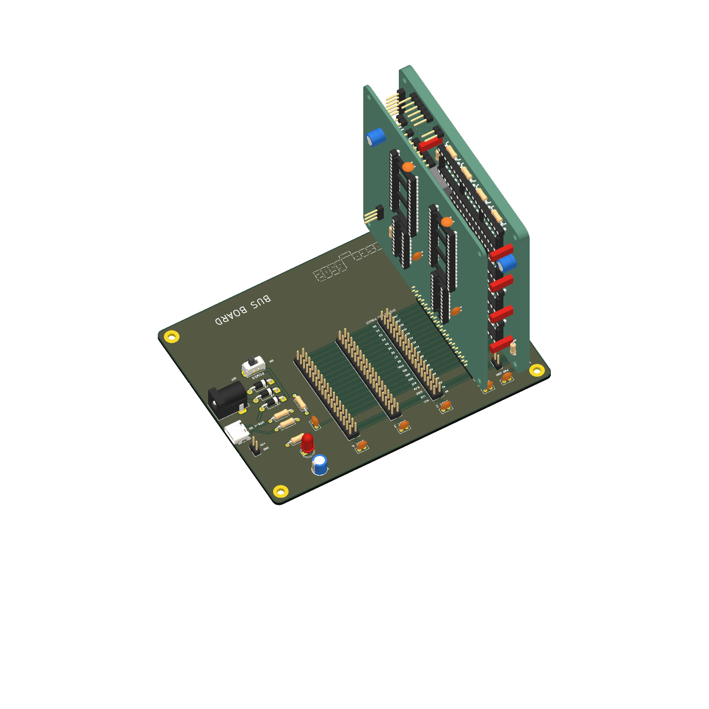

# Backplane Specification: rosco_6502 Vertical Bus Architecture

Mechanical and electrical specification for the vertical expansion bus system used by the [rosco_6502](https://github.com/rosco-m68k/rosco_6502) single-board computer and peripheral daughterboards.

---

## 1. Interconnect Architecture & Mating Concept

- **Busboard (Backplane):** HOST and expansion slots (SLOT 1–4) utilize straight male pin headers (2×18, 2.54 mm / 0.1" pitch) mounted on the top side of the board.
- **Daughterboards (Host SBC & Expansion Cards):** All cards use right-angle female pin sockets (2×18, 2.54 mm pitch) mounted on the bottom (`B.Cu`) layer along the right edge of the PCB.
- **Orientation & Insertion:** 
  - Each daughterboard inserts with its right edge facing downwards, standing perpendicular (vertical) to the busboard.
  - The component side of each card faces towards the next slot (towards the right).
  - No riser, bridge board, or intermediate right-angle adapter is needed.
- **Footprint:** Daughterboards use the footprint `RoscoBackplane:PinSocket_2x18_P2.54mm_Horizontal_RoscoBottom`. Its geometry conforms to standard right-angle female pin sockets with silkscreen markings trimmed at the board edge. When soldered to `B.Cu`, the pinout corresponds 1:1 with the rosco_6502 expansion bus.
- **Hot-Plugging:** Always power down the system before inserting or removing cards.

---

## 2. Shared Daughterboard Form Factor

Both the rosco_6502 host computer and expansion daughterboards (such as the RAM expansion board) share a standardized **100 × 100 mm** PCB contour with identical mounting hole positions and connector placement.

> **Design Rationale:** The bus connector is deliberately **not** centered along the 100 mm edge. It preserves the original rosco_6502 `J5` connector placement to avoid redesigning or re-routing the CPU host board. By using identical connector offsets across all boards, daughterboards share the exact same mating height, flush aligned edges, and consistent spacing.

### Coordinate Reference (100 × 100 mm Daughterboard)

*Origin (0, 0) is located at the top-left corner of the board contour, viewed from the front / component side.*

| Element | X (mm) | Y (mm) | Description |
|:---|---:|---:|:---|
| **Pin 1** | 94.225 | 14.425 | Square pad (A0) |
| **Pin 2** | 96.765 | 14.425 | VCC / VCC_HOST |
| **Pin 35** | 94.225 | 57.605 | ~ML |
| **Pin 36** | 96.765 | 57.605 | D0 |
| **Top-Left Hole** | 4.450 | 4.450 | M3 mounting hole (Ø3.2 mm / Ø3.5 mm) |
| **Top-Right Hole** | 95.550 | 4.450 | M3 mounting hole |
| **Bottom-Left Hole** | 4.450 | 95.550 | M3 mounting hole |
| **Bottom-Right Hole** | 95.550 | 95.550 | M3 mounting hole |

- **Y-Axis Center & Offset:** The centerline of the 2×18 connector field along the Y-axis is located at `Y = 36.015 mm`, representing an offset of `13.985 mm` from the board centerline (`Y = 50.000 mm`).
- **Mounting Holes:** M3 mounting holes are placed 4.45 mm from board edges on all four corners.

---

## 3. Busboard Dimensions & Slot Pitch

The busboard measures **132 × 100 mm** with a uniform slot pitch of **20 mm**:

- **HOST Slot:** Pin 1 is located at `(X = 6.000 mm, Y = 14.425 mm)`
- **SLOT 1:** Pin 1 is located at `(X = 26.000 mm, Y = 14.425 mm)`
- **SLOT 2:** Pin 1 is located at `(X = 46.000 mm, Y = 14.425 mm)`
- **SLOT 3:** Pin 1 is located at `(X = 66.000 mm, Y = 14.425 mm)`
- **SLOT 4:** Pin 1 is located at `(X = 86.000 mm, Y = 14.425 mm)`
- **Mounting Holes:** 4× M3 mounting holes (3.2 mm diameter with grounding annular rings) are located near the four corners.

---

## 4. Power Delivery & Isolation (JP1 PWR LINK)

- **Power Inputs:** 5V DC supplied through:
  - USB Type-C receptacle (`J3`, with 5.1 kΩ CC pull-downs)
  - DC Barrel Jack (`J1`, 5.5 / 2.1 mm center-positive)
  - 2-pin screw terminal / header (`J2`, 5V IN)
- **Input Protection:** Three 1N5819 Schottky diodes (`D1`, `D2`, `D3`) provide diode OR-ing to prevent back-powering between sources.
- **Power Switch:** `SW1` connects diode-isolated `VIN` to the board's `VCC` rail.
- **Power Link (`JP1`):**
  - **Jumper Installed (Default):** The host slot (`VCC_HOST`) and peripheral slots (`VCC`) are tied together, powering the entire system from the busboard.
  - **Jumper Removed:** The host slot (`BUS1`) power rail is isolated, allowing the rosco_6502 SBC to be powered via its own onboard serial adapter or power supply while peripheral cards are powered from the busboard.

---

## 5. Design Verification & Status

- **Busboard:** Passed Electrical Rules Check (ERC: 0 errors, 0 warnings) and Design Rules Check (DRC: 0 errors, 0 unrouted nets).
- **Signal Integrity:** Direct straight bus lines across all five slots with 470 µF bulk decoupling and individual 100 nF bypass capacitors at each expansion slot.
