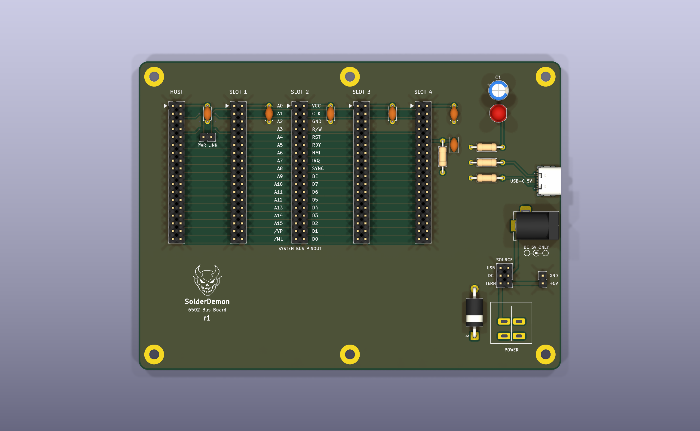
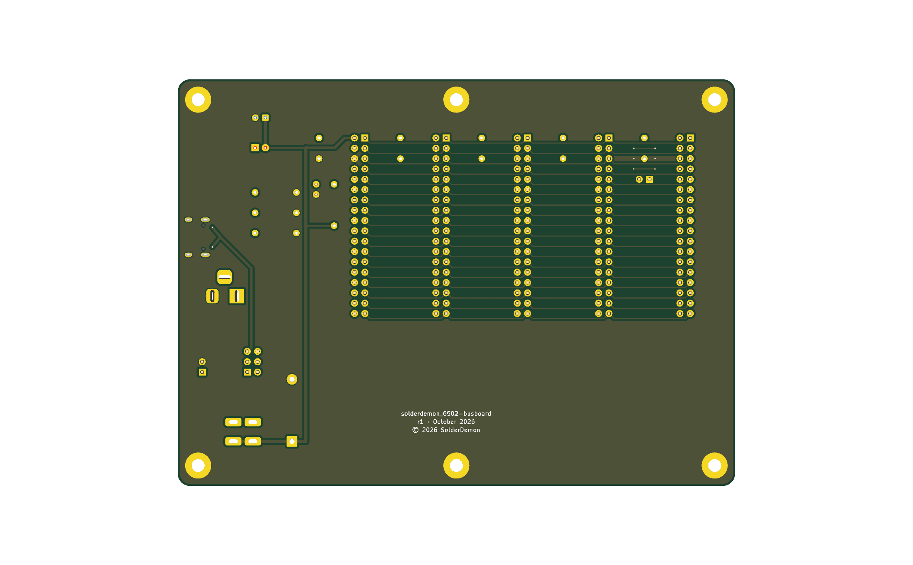

# SolderDemon 6502 Bus Board

A 5-slot expansion busboard for the SolderDemon 6502 computer. The 36-pin bus keeps the [rosco_6502](https://github.com/rosco-m68k/rosco_6502) pin order, so cards made for that bus fit.

Designed as a modular vertical-card backplane architecture featuring 1 dedicated host connection for the SolderDemon 6502 CPU board and 4 peripheral expansion slots (e.g., RAM boards, I/O controllers), along with flexible 5V power delivery and host isolation options.

## Start here

- [KiCad project](design/solderdemon_6502-busboard.kicad_pro)
- [Schematic (PDF)](manufacturing/solderdemon_6502-busboard-schematic.pdf)
- [Gerbers and drill files](manufacturing/solderdemon_6502-busboard-gerbers.zip)
- [Assembly BOM](manufacturing/bom.csv)
- [Host mounting and first build](#host-mounting-and-first-build)

## Highlights

- **Slot Architecture:** 1 Host Slot (`BUS1`) + 4 Expansion Slots (`BUS2`–`BUS5` = SLOT 1–4, each with its 100 nF `C3`–`C6`) using standard 2×18 vertical pin headers (2.54 mm / 0.1" pitch, 20 mm slot pitch). The host and the cards stand upright in their slots on right-angle 2×18 sockets, all facing the same way; a silkscreen triangle marks pin 1 of every slot; as on the SolderDemon m68k busboard, each slot's decoupler stands on the half-pitch line to its right, beside pin 1, clear of every board plane
- **Power Inputs:** Triple 5V power input options:
  - USB Type-C receptacle (`J3`, USB 2.0 power delivery with onboard 5.1 kΩ CC pull-downs)
  - 5.5 / 2.1 mm DC Barrel Jack (`J1`, center-positive)
  - 2-pin screw terminal / vertical header block (`J2`, 5V IN)
- **Source Selection:** one jumper cap on the 2×3 header `JP2` picks the input: the USB, DC or TERM row, in the order of the inputs down the right edge (USB-C, DC jack, then the terminal `J2` under the jack). No diodes, so no 0.3–0.6 V drop: the bus gets the supply voltage. Never fit two source jumpers
- **Protection:** a 1.5KE6.8A unidirectional TVS (`D1`) from `VCC` to GND. There is no fuse: a reversed or wrong-voltage adapter is shorted by `D1`, and only the adapter's own current limit stops it
- **Power Control & Filtering:** NKK M2021SS1W01 DPST toggle (`SW1`, the switch of the SolderDemon m68k busboard; both poles in parallel), PWR GOOD LED indicator (`LED1`), 470 µF bulk electrolytic reservoir (`C1`), five 100 nF bypass capacitors (`C2`–`C6`) and the bus `~RESET` pull-up `R2` with `C7`
- **Host Power Isolation (`JP1`):** Allows powering the host SBC independently (e.g., via USB serial adapter) while powering peripheral slots from the backplane
- **Form Factor:** 137 × 100 mm 2-layer PCB, all through-hole components (except USB-C receptacle) for straightforward DIY assembly
- **Mounting:** 6× M3 mounting holes with grounded annular pads, three along each long edge: the four corners plus the middle of the top and bottom edge, halfway between the corner holes

## Pinout

The busboard exposes the 36-pin SolderDemon 6502 bus (rosco_6502-compatible pin order) across all five slots:

| Pin | Signal | Description | Pin | Signal | Description |
|:---:|:---|:---|:---:|:---|:---|
| **1** | **A0** | Address Bus bit 0 (square pad) | **2** | **VCC / VCC_HOST** | +5V Power Rail (Host isolated via JP1) |
| **3** | **A1** | Address Bus bit 1 | **4** | **CLK** | CPU Phase 2 System Clock (PHI2) |
| **5** | **A2** | Address Bus bit 2 | **6** | **GND** | System Ground (0V) |
| **7** | **A3** | Address Bus bit 3 | **8** | **R/~W** | Read / ~Write Control Line |
| **9** | **A4** | Address Bus bit 4 | **10** | **~RESET** | Active-Low System Reset |
| **11** | **A5** | Address Bus bit 5 | **12** | **RDY** | 65C02 CPU Ready Line |
| **13** | **A6** | Address Bus bit 6 | **14** | **~NMI** | Non-Maskable Interrupt Request |
| **15** | **A7** | Address Bus bit 7 | **16** | **~IRQ** | Maskable Interrupt Request |
| **17** | **A8** | Address Bus bit 8 | **18** | **SYNC** | Opcode Fetch Cycle Indicator |
| **19** | **A9** | Address Bus bit 9 | **20** | **BE** | Bus Enable Line |
| **21** | **A10** | Address Bus bit 10 | **22** | **D7** | Data Bus bit 7 |
| **23** | **A11** | Address Bus bit 11 | **24** | **D6** | Data Bus bit 6 |
| **25** | **A12** | Address Bus bit 12 | **26** | **D5** | Data Bus bit 5 |
| **27** | **A13** | Address Bus bit 13 | **28** | **D4** | Data Bus bit 4 |
| **29** | **A14** | Address Bus bit 14 | **30** | **D3** | Data Bus bit 3 |
| **31** | **A15** | Address Bus bit 15 | **32** | **D2** | Data Bus bit 2 |
| **33** | **~VP** | Vector Pull Indicator | **34** | **D1** | Data Bus bit 1 |
| **35** | **~ML** | Memory Lock Indicator | **36** | **D0** | Data Bus bit 0 |

### Power Interfaces & Control

| Designator | Label | Type / Footprint | Description |
|:---|:---|:---|:---|
| **J1** | DC IN | Barrel Jack 5.5 / 2.1 mm | 5V DC power input (center-positive) |
| **J2** | 5V IN | Pin Header / Terminal 1×02 | Auxiliary 5V DC power input, on the right edge under the DC jack |
| **J3** | USB-C 5V | USB Type-C Receptacle | 5V DC USB power input with CC pull-down resistors |
| **JP2** | SOURCE | Pin Header 2×03, 2.54 mm | Source select: one jumper cap across the USB, DC or TERM row |
| **SW1** | POWER | NKK M2021SS1W01 DPST toggle | Main power ON / OFF switch |
| **JP1** | PWR LINK | Pin Header 1×02, 2.54 mm | Power link jumper: links `VCC_HOST` to bus `VCC` |

> **Note on JP1 (PWR LINK):** When jumpered (default), all slots share the busboard 5V rail. When unjumpered, the host slot (`BUS1`) receives power from its own onboard source or serial adapter, preventing current loops while still sharing ground and signals.

## Host mounting and first build

The SolderDemon 6502 r1 host carries a right-angle female 2×18 socket on its J5 pads (KiCad `PinSocket_2x18_P2.54mm_Horizontal`; pin 2 is the pad nearer the body, i.e. the pads are the stock header mirrored) and stands upright in HOST, component side toward the busboard's left edge, its top edge level with the busboard's top edge. The compact SolderDemon 6502 RAM card uses the mirrored socket on B.Cu at its **right** edge and stands with its component side toward the next slot. Its pin 1 must align with the triangle at the top of the slot; all 36 contacts and the mirrored footprint geometry are checked against the current PCB files by its `tools/check_design.py`. Bolt the busboard through its six M3 holes to a case or rigid base before inserting any board. Do not connect J5 to HOST with a ribbon cable instead: because J5's pin order is mirrored for the socket, a plain 36-way ribbon between J5 and the straight HOST header swaps every odd/even pair and puts `VCC` on `A0`. The mating model (contact-row heights, edge height, clearances) is in [BACKPLANE.md](BACKPLANE.md).

The selected input carries the full board load through `SW1`; measure total current and voltage at the farthest slot before populating all five slots. The first order should be a prototype run, followed by pin-1 continuity, power and loaded-voltage checks.

## Board Views

| Top Side | Bottom Side |
|:---:|:---:|
|  |  |

## Bill of Materials (BOM)

| Reference | Value | Package / Footprint | Notes |
|:---|:---|:---|:---|
| **BUS1–BUS5** | Conn_02x18 | PinHeader 2×18, 2.54 mm, Vertical | Host slot (`BUS1`) & 4 expansion slots (`BUS2`–`BUS5`) |
| **J1** | Barrel Jack | BarrelJack_Horizontal 5.5 / 2.1 mm | 5V DC input |
| **J2** | Conn_01x02 | PinHeader 1×02, 2.54 mm, Vertical | Auxiliary 5V screw terminal or pin header |
| **J3** | USB-C 16P | USB4105-xx-A Top Mount | USB Type-C 5V power receptacle |
| **JP1** | Conn_01x02 | PinHeader 1×02, 2.54 mm, Vertical | PWR LINK host power isolation jumper |
| **JP2** | Conn_02x03 + one jumper cap | PinHeader 2×03, 2.54 mm, Vertical | Source select: odd pins 1 terminal, 3 DC jack, 5 USB-C; even pins the common input |
| **D1** | 1.5KE6.8A | DO-201AE, Axial (THT) | Unidirectional TVS, 5.8 V standoff, across `VCC` |
| **SW1** | NKK M2021SS1W01 | NKK-M2021SS1W01 (SolderDemon.pretty) | DPST ON-OFF toggle, both poles in parallel; as on the m68k busboard |
| **LED1** | LED 5 mm | Radial D5.0 mm (THT) | PWR GOOD 5V rail status indicator |
| **C1** | 470 µF | Radial D6.3 mm, P2.5 mm | Bulk electrolytic reservoir capacitor |
| **C2–C6** | 100 nF | Radial 5.08 mm pitch | Decoupling: `C2` HOST, `C3`–`C6` SLOT 1–4 |
| **C7** | 1 nF | Disc D5.0 mm, P2.5 mm | Bus `~RESET` noise capacitor, with `R2`. Small on purpose: the host drives `~RESET` open-drain from its CPLD with its own 3.3 kΩ pull-up, and 100 nF would dump into that pin on every reset and stretch the release to ~250 µs |
| **R1** | 1 kΩ | Axial DIN0207, P10.16 mm | Current-limiting resistor for LED1 |
| **R2** | 10 kΩ | Axial DIN0207, P10.16 mm | Bus `~RESET` pull-up |
| **R3, R4** | 5.1 kΩ | Axial DIN0207, P10.16 mm | USB Type-C CC1 / CC2 pull-down resistors |
| **H1–H6** | Mounting Hole | 3.2 mm M3 with Ground Pad | Corners (`H1`–`H4`), middle of the top and bottom edge (`H5`, `H6`) |

## Manufacturing & Hardware Files

- **KiCad Project:** [design/](design/)
- **Footprint Libraries:** `SolderDemon.pretty/` (logo), `SolderDemonBus.pretty/`, `SolderDemonDirectMount.pretty/`
- **Schematic PDF:** [SolderDemon 6502 busboard schematic](manufacturing/solderdemon_6502-busboard-schematic.pdf)
- **Gerbers:**
  - Prototype fabrication archive: [solderdemon_6502-busboard-gerbers.zip](manufacturing/solderdemon_6502-busboard-gerbers.zip)
  - Unpacked fresh layers in [manufacturing/gerber/](manufacturing/gerber/) folder
- **PCB Specs:** 2-layer board, 137 × 100 mm, 1.6 mm thickness, standard 1 oz copper, HASL / ENIG finish
- **Design Verification:** [DRC Report](solderdemon_6502-busboard-drc.rpt) (KiCad 10.0.8 reports 4 hole-clearance errors at J3, 0 unrouted pads and 35 schematic-parity warnings), [ERC Report](solderdemon_6502-busboard-erc.rpt) (0 violations)
- **Backplane Specification:** [BACKPLANE.md](BACKPLANE.md) — mechanical dimensions, slot spacing, connector mating, and daughterboard form factor guidelines.

## Licences and attribution

- **Hardware:** [CERN Open Hardware Licence v1.2](LICENCE.hardware.txt).
- **Documentation:** [Creative Commons Attribution 4.0](https://creativecommons.org/licenses/by/4.0/).

SolderDemon backplane for the [rosco_6502](https://github.com/rosco-m68k/rosco_6502) expansion interface. Original rosco_6502 authorship: Ross Bamford & Contributors. Retained source and third-party notices identify their respective authors.

<!-- repository-layout -->
## Repository layout

- [`design/`](design/solderdemon_6502-busboard.kicad_pro) holds the KiCad project, schematic, PCB and local libraries.
- [`code/firmware/`](code/firmware/) — This busboard has no programmable devices.
- [`code/software/`](code/software/) — The backplane requires no drivers or applications.
- [`code/build/`](code/build/) — Local build products.
- [`tools/`](tools/) — Design generators and verification.
- [`manufacturing/`](manufacturing/) — Fabrication files and schematic PDF.
- [`images/`](images/) — Board views and artwork.

Open the project in `design/`. Use the scripts in `tools/` to change the design. The `.kicad_pro` file holds the DRC rules.
<!-- /repository-layout -->

## Fabrication status

The current files are for prototype review. KiCad 10.0.8 reports four hole-clearance errors at USB-C connector J3. Review those clearances before fabrication.
