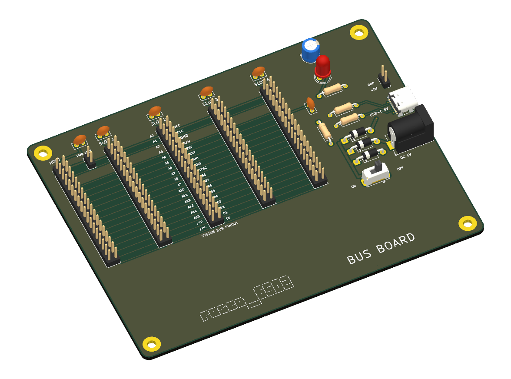
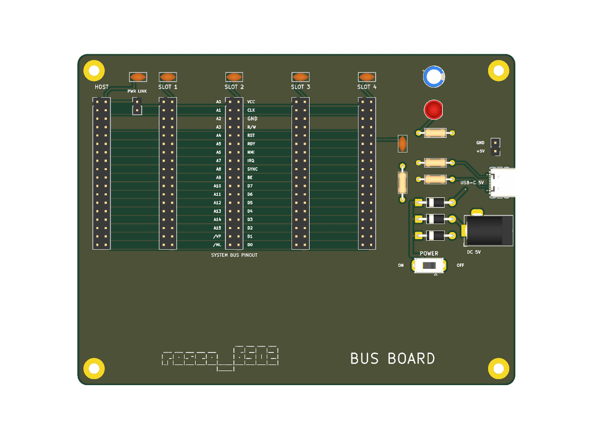
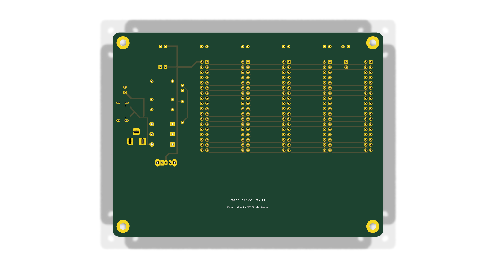

# rosco_6502 Bus Board (roscbus6502)

A 5-slot expansion bus backplane for the [rosco_6502](https://github.com/rosco-m68k/rosco_6502) single-board computer.

Designed as a modular vertical-card backplane architecture featuring 1 dedicated host slot for the rosco_6502 CPU SBC and 4 peripheral expansion slots (e.g., RAM boards, I/O controllers), along with flexible 5V power delivery and host isolation options.

## Highlights

- **Slot Architecture:** 1 Host Slot (`BUS1`) + 4 Expansion Slots (`BUS2`–`BUS5`) using standard 2×18 vertical pin headers (2.54 mm / 0.1" pitch, 20 mm slot pitch)
- **Power Inputs:** Triple 5V power input options:
  - USB Type-C receptacle (`J3`, USB 2.0 power delivery with onboard 5.1 kΩ CC pull-downs)
  - 5.5 / 2.1 mm DC Barrel Jack (`J1`, center-positive)
  - 2-pin screw terminal / vertical header block (`J2`, 5V IN)
- **Power Protection & OR-ing:** Triple 1N5819 Schottky diodes (`D1`, `D2`, `D3`) prevent back-powering between connected power sources
- **Power Control & Filtering:** SPDT slide power switch (`SW1`), PWR GOOD LED indicator (`LED1`), 470 µF bulk electrolytic reservoir (`C1`), and six 100 nF ceramic bypass capacitors (`C2`–`C7`)
- **Host Power Isolation (`JP1`):** Allows powering the host SBC independently (e.g., via USB serial adapter) while powering peripheral slots from the backplane
- **Form Factor:** 132 × 100 mm 2-layer PCB, all through-hole components (except USB-C receptacle) for straightforward DIY assembly
- **Mounting:** 4× M3 mounting holes with grounded annular pads at board corners

## Pinout

The backplane exposes the 36-pin rosco_6502 expansion bus across all five slots:

| Pin | Signal | Description | Pin | Signal | Description |
|:---:|:---|:---|:---:|:---|:---|
| **1** | **A0** | Address Bus bit 0 (square pad) | **2** | **VCC / VCC_HOST** | +5V Power Rail (Host isolated via JP1) |
| **3** | **A1** | Address Bus bit 1 | **4** | **CLK** | CPU Phase 2 System Clock (PHI2) |
| **5** | **A2** | Address Bus bit 2 | **6** | **GND** | System Ground (0V) |
| **7** | **A3** | Address Bus bit 3 | **8** | **R/~W** | Read / ~Write Control Line |
| **9** | **A4** | Address Bus bit 4 | **10** | **~RESET** | Active-Low System Reset |
| **11** | **A5** | Address Bus bit 5 | **12** | **RDY** | 65C02 CPU Ready Line |
| **13** | **A6** | Address Bus bit 6 | **14** | **~NMI** | Non-Maskable Interrupt Request |
| **15** | **A7** | Address Bus bit 7 | **16** | **~IRQ** | Maskable Interrupt Request |
| **17** | **A8** | Address Bus bit 8 | **18** | **SYNC** | Opcode Fetch Cycle Indicator |
| **19** | **A9** | Address Bus bit 9 | **20** | **BE** | Bus Enable Line |
| **21** | **A10** | Address Bus bit 10 | **22** | **D7** | Data Bus bit 7 |
| **23** | **A11** | Address Bus bit 11 | **24** | **D6** | Data Bus bit 6 |
| **25** | **A12** | Address Bus bit 12 | **26** | **D5** | Data Bus bit 5 |
| **27** | **A13** | Address Bus bit 13 | **28** | **D4** | Data Bus bit 4 |
| **29** | **A14** | Address Bus bit 14 | **30** | **D3** | Data Bus bit 3 |
| **31** | **A15** | Address Bus bit 15 | **32** | **D2** | Data Bus bit 2 |
| **33** | **~VP** | Vector Pull Indicator | **34** | **D1** | Data Bus bit 1 |
| **35** | **~ML** | Memory Lock Indicator | **36** | **D0** | Data Bus bit 0 |

### Power Interfaces & Control

| Designator | Label | Type / Footprint | Description |
|:---|:---|:---|:---|
| **J1** | DC IN | Barrel Jack 5.5 / 2.1 mm | 5V DC power input (center-positive) |
| **J2** | 5V IN | Pin Header / Terminal 1×02 | Auxiliary 5V DC power input |
| **J3** | USB-C 5V | USB Type-C Receptacle | 5V DC USB power input with CC pull-down resistors |
| **SW1** | POWER | SPDT Slide Switch | Main power ON / OFF switch |
| **JP1** | PWR LINK | Pin Header 1×02, 2.54 mm | Power link jumper: links `VCC_HOST` to bus `VCC` |

> **Note on JP1 (PWR LINK):** When jumpered (default), all slots share the busboard 5V rail. When unjumpered, the host slot (`BUS1`) receives power from its own onboard source or serial adapter, preventing current loops while still sharing ground and signals.

## Board Views

| Top Side | Bottom Side |
|:---:|:---:|
|  |  |

## Bill of Materials (BOM)

| Reference | Value | Package / Footprint | Notes |
|:---|:---|:---|:---|
| **BUS1–BUS5** | Conn_02x18 | PinHeader 2×18, 2.54 mm, Vertical | Host slot (`BUS1`) & 4 expansion slots (`BUS2`–`BUS5`) |
| **J1** | Barrel Jack | BarrelJack_Horizontal 5.5 / 2.1 mm | 5V DC input |
| **J2** | Conn_01x02 | PinHeader 1×02, 2.54 mm, Vertical | Auxiliary 5V screw terminal or pin header |
| **J3** | USB-C 16P | USB4105-xx-A Top Mount | USB Type-C 5V power receptacle |
| **JP1** | Conn_01x02 | PinHeader 1×02, 2.54 mm, Vertical | PWR LINK host power isolation jumper |
| **SW1** | OS102011MS2Q | SW_Slide_SPDT_Straight | Main power switch |
| **D1, D2, D3** | 1N5819 | DO-41, Axial (THT) | Schottky diodes for power source OR-ing |
| **LED1** | LED 5 mm | Radial D5.0 mm (THT) | PWR GOOD 5V rail status indicator |
| **C1** | 470 µF | Radial D6.3 mm, P2.5 mm | Bulk electrolytic reservoir capacitor |
| **C2–C7** | 100 nF | Disc D5.0 mm, P2.5 mm | High-frequency ceramic decoupling capacitors |
| **R1** | 1 kΩ | Axial DIN0207, P10.16 mm | Current-limiting resistor for LED1 |
| **R2** | 10 kΩ | Axial DIN0207, P10.16 mm | Bleeder resistor |
| **R3, R4** | 5.1 kΩ | Axial DIN0207, P10.16 mm | USB Type-C CC1 / CC2 pull-down resistors |
| **H1–H4** | Mounting Hole | 3.2 mm M3 with Ground Pad | Corner mounting holes |

## Manufacturing & Hardware Files

- **KiCad Project:** `rosco_6502-busboard.kicad_pro`, `rosco_6502-busboard.kicad_sch`, `rosco_6502-busboard.kicad_pcb`
- **Footprint Libraries:** `RoscoBackplane.pretty/`, `RoscoDirectMount.pretty/`
- **Schematic PDF:** [rosco_6502-busboard.pdf](rosco_6502-busboard.pdf)
- **Gerbers:**
  - Ready-to-order archive: [rosco_6502_busboard_production_gerber.zip](rosco_6502_busboard_production_gerber.zip)
  - Unpacked layers in [gerber/](gerber/) folder
- **PCB Specs:** 2-layer board, 132 × 100 mm, 1.6 mm thickness, standard 1 oz copper, HASL / ENIG finish
- **Design Verification:** [DRC Report](rosco_6502-busboard-drc.rpt) (0 errors), [ERC Report](rosco_6502-busboard-erc.rpt) (0 errors)
- **Backplane Specification:** [BACKPLANE.md](BACKPLANE.md) — mechanical dimensions, slot spacing, connector mating, and daughterboard form factor guidelines.

## License

- **Hardware:** CERN Open Hardware Licence Version 2 — Strongly Reciprocal ([CERN-OHL-S v2](LICENCE.hardware.txt)).
- **Documentation:** Creative Commons Attribution (CC-BY 4.0).
